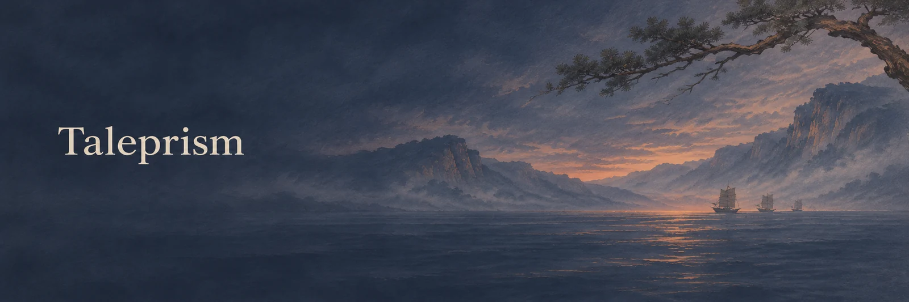
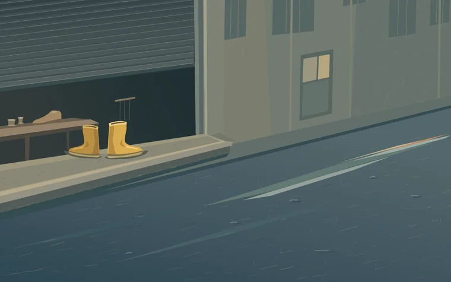

# 

**Keep every word of the novel. Let pictures and sound arrive at the passage where they belong.**

[**Read Chibi online →**](https://ethereal-space-one.github.io/taleprism/) · [**Bring your own novel →**](#start-with-one-chapter)

*Chibi (Red Cliffs) · The actual reader cover*

## One image, one sound

<table>
<tr>
<td width="50%" valign="top">
 
<strong>Chibi · The wind enters first</strong> 
You hear the wind only as the flags begin to turn.
</td>
<td width="50%" valign="top">
 
<strong>The Door Left Open · Rain outside</strong> 
The boots stay still. Rain and a passing car belong to one passage.
</td>
</tr>
</table>

Chibi reveals its map, factions, and causes at the point you reach in the story. Going back hides later outcomes again. To hear the wind, search for `旗旛轉動` and choose **听此处声景 · 风声** at the end of the passage. It is one synthesized sound cue, not a chapter-long soundtrack. Automatic cues occur during forward reading, not as catch-up playback after search. The still illustration appears a little later; the sound does not animate it.

In *The Door Left Open*, only the wet road on the right moves. The dry threshold and the boots do not. Readers can choose quiet reading, pause automatic cues, mute sound, or use their system's reduced-motion setting.

## Start with one chapter

1. **Download one package.** Get the [AI Author Starter](https://github.com/Ethereal-Space-one/taleprism/releases/download/v0.9.3/taleprism-agent-starter.zip), extract it, and add a chapter such as `chapter.txt` beside `prompts/`. Open the folder in Codex or Claude Code. In an upload-only chat, attach the chapter and the two templates below.
2. **Ask for a brief, not finished images.** Send this to your agent:

   > Use Taleprism for this chapter. Read `prompts/01-source.md`, `prompts/03-shot-plan.md`, and `chapter.txt`, or the matching attachments. Keep the source unchanged. Pick one to three places where an illustration would help. For each, give the paragraph, exact quote, what the image helps a reader understand, and what it must not reveal yet. Separate inference from fact. Return Markdown and stop for my review before generating images.

3. **Make an edition when you’re ready.** Use your chosen image tool after reviewing the brief. To share a book, bring the original TXT and approved art into the workbench, place images at their passages, preview, and export a standalone reader.

The starter isn't a plugin and doesn't require a Taleprism key. External services are your choice. [Full agent walkthrough](prompts/START-HERE.md#english-walkthrough)

## Open a finished work, or make your own

**Chibi** shows how to stage an ensemble and reveal a battle. **Last Light** gives you a guided three-shot exercise in character, camera, and prop continuity. Each comes in one ZIP: open `Reader/index.html` to read or import the included `Project.zip` into the workbench to edit. *The Door Left Open* and *The Margin* are reader-only.

To install the local workbench, extract the source package and run `./start.sh` (Python 3.11+, uv, Node.js 22.12+, npm; first setup needs a connection). Later, use `./run.sh`. On macOS, you can also open **打开Taleprism.command**.

**[Works and downloads](docs/DOWNLOADS.md#works-and-downloads)** · [Workbench setup (Chinese)](docs/快速上手.md)

## Not every picture needs to move

Review each finished illustration at its source passage. Stillness is a valid choice. As a final, optional step, an agent can propose a sound, an image treatment, or a way to reveal text. Only the author's choices enter the book, and the standalone reader never calls AI. Share a reader ZIP and keep the editable project as a separate backup.

[v0.9.3 release notes](https://github.com/Ethereal-Space-one/taleprism/releases/tag/v0.9.3) · [中文](README.md)
