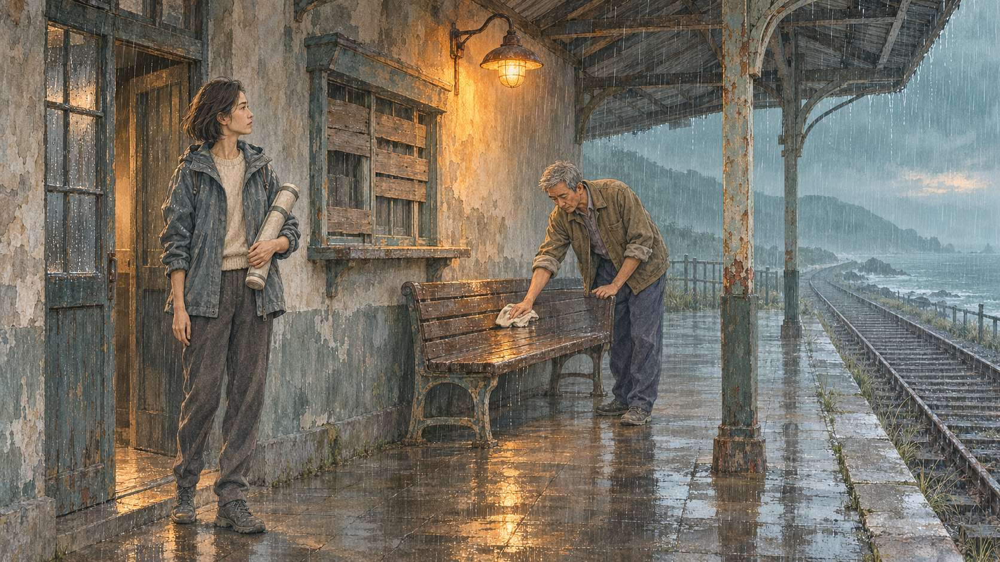
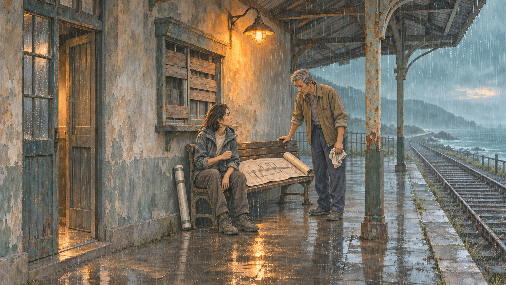
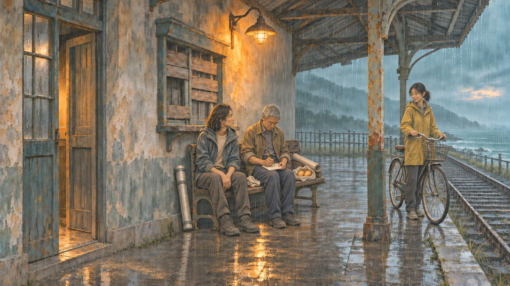

# Last Light: a three-frame continuity walkthrough

Make a readable scene from fiction without changing its text. [中文](README.md) · [Download the Last Light reader](https://github.com/Ethereal-Space-one/taleprism/releases/download/v0.2.0/taleprism-v0.2.0-last-light-reader.zip) · [Downloads](https://github.com/Ethereal-Space-one/taleprism/releases/tag/v0.2.0)

No workbench installation is needed for the prompt route. Download the source or prompt starter ZIP, keep its folders together, and open `prompts/README.md`. The eight templates include copyable instructions and fully filled examples. Actual image generation uses your own chosen service and may require an account or payment. Attach actual images; a filename in a prompt does not upload a reference.

## Story and files

The original Chinese fiction is in `samples/last-light/source.txt`. Lin Yao, a 32-year-old redevelopment worker, comes to an old coastal station to finish an inventory. Chen Bo, a 62-year-old retired station attendant, still lights the lamp. Nineteen-year-old Xiao Man arrives with a bicycle and bread. Their conversation shifts from preserving an object to understanding a place still used by people. The ending does not promise permanent preservation or approval of the redevelopment plan.

P00 is the title; P01–P08 are the eight following paragraphs. This English synopsis explains the task; it does not replace or alter the source. `worksheet.json` contains the full paragraph map, acting and object states; `references.json` maps the original files and their hashes.

| File in `samples/last-light/` | Responsibility |
| --- | --- |
| `linyao-v1.png`, `chenbo-v1.png` | Identity references, not poses to copy |
| `arrival-v1.png` | Environment master and first frame |
| `negotiation-v2.png` | Corrected second frame |
| `recording-v2.png` | Third frame after basket repair |
| `recipe.json` | Full direction and continuity worksheet |
| `continuity-prompts-v2.json` | Historical generation and repair instructions |
| `continuity-review.json`, `PROVENANCE.md` | Hash-bound assistant checks and provenance; final creator art review remains pending |

## 1. Evidence and acting

Use [01](../../prompts/01-source.md), then [02](../../prompts/02-character.md). Lin Yao wants a credible preservation plan; Chen Bo wants to know who will actually use the lamp. Her withdrawn pointing hand and attentive gaze express listening; his reserved gaze and question express concern. Avoid a cold bureaucrat versus an unreasonable old man, or two matching smiles suggesting an agreement that has not happened.

P03 mentions a table edge although the established setting centers on a bench. The visual interpretation uses the bench-side working area without adding a table. Sitting on the bench is also artistic blocking. Keep the novel unchanged and label these decisions as interpretations.

## 2. Budget three meaningful pictures

Use [03](../../prompts/03-shot-plan.md) with budget 3:

1. After P01: establish the station, Lin holding a survey tube and Chen wiping water. No Xiao Man, bicycle or bread.
2. After P03: the question changes their relationship. The plan lies on the bench; Lin starts listening. No recording or resolution yet.
3. After P06: Chen starts writing; Xiao Man and her bicycle have arrived in P05. Show tentative cooperation, not a preservation guarantee.

The camera remains fixed deliberately. This example verifies continuity at that camera, not arbitrary reverse shots or a reconstructed 3D location.

## 3. Fix the space and track objects

Use [04](../../prompts/04-scene.md). The doorway, boarded window, single lamp, original bench, post and tracks are spatial anchors. Do not lengthen the bench to seat people.

| Prop | Arrival | Negotiation | Recording |
| --- | --- | --- | --- |
| Survey tube | Under Lin's arm | Against wall left of bench | Same position |
| Large plan | Rolled inside tube, offscreen | Open on bench | Rolled at right bench end |
| Wiping cloth | In Chen's hand | Still in hand | On bench between people |
| Bicycle and basket | Not yet arrived | Not yet arrived | Xiao Man brings bike; basket now empty |
| Bread wrapping | With absent Xiao Man | Not yet arrived | Bread taken out and put on bench |
| Small sheet and pencil | Not used, offscreen | Not used, offscreen | On Chen's lap and in his hand |

The complete worksheet tracks 11 objects. Placing the tube, rolling the plan and setting down the cloth are labelled bridging interpretations. Large plan, small sheet, wiping cloth and bread wrapping are distinct.

## 4. Start from an inspected master

Either reuse `arrival-v1.png`, or attach the two identity portraits and fill [05](../../prompts/05-first-image.md) to generate your own master. Review actual faces, layout and props with [07](../../prompts/07-review.md). Repair the master before using it downstream.

## 5. Edit the negotiation

Use your checked master as the edit target and fill [06](../../prompts/06-continuation.md) for P03. Change poses, open the plan, and place the tube to the left; preserve the architecture, camera and bench dimensions.

The historical candidate extended the bench leftward. It was repaired against the master before continuing. That intermediate candidate is not included in this public kit; the older v1 file is a previous workflow version, not this specific failed intermediate. The exact repair instructions are preserved in the prompt log.

## 6. Continue into recording, then repair

Attach `negotiation-v2.png` first as EDIT TARGET / previous checked frame, and `arrival-v1.png` second as environment master. Fill [06](../../prompts/06-continuation.md) for P06. Chen sits and writes, the plan rolls to the right, the tube stays left, and cloth and bread remain distinct. Xiao Man and the bicycle have entered only after their textual arrival.

The candidate omitted the bicycle basket. Use [08](../../prompts/08-repair.md) to add only an empty front basket: the bread has already moved onto the bench. Protect faces, poses, geometry and every unrelated prop. Inspect the whole repaired frame; sending a correction is not proof that it worked.

## 7. Review and record honestly

Compare master, previous checked frame and current output. Check source timing, identity, each side's acting, fixed geometry and every prop state. Record observations, uncertainty and reviewer identity. Any material upstream change requires rechecking dependent frames. Brushwork and local contours may still drift; this is not pixel-perfect locking.

For the overall workflow comparison, see [old negotiation](../../samples/last-light/negotiation-v1.png) versus [v2](../../samples/last-light/negotiation-v2.png), and [old recording](../../samples/last-light/recording-v1.png) versus [v2](../../samples/last-light/recording-v2.png). Do not treat these pairs as the bench/basket intermediate repair captures.

## 8. Share the reading result

For a finished reader, install the [workbench](../../README.en.md), import the source, review characters, fill the direction plan, upload/accept pictures, record continuity checks and apply the plan. Export an independent reader ZIP. Serve the extracted directory over HTTP; do not double-click its HTML file.

To inspect the supplied editable project, download the Release file ending in `last-light-project.zip`, then use the left sidebar's **示例与工程 → 导入可编辑工程**. Each import creates a new project. Reader and editable-project ZIPs have different purposes. The public sample excludes macOS-generated demonstration audio. Voice production is optional and requires listening and acceptance; cloud OpenAI speech has not been live-validated.

The workbench UI is currently Chinese. External-user usability has not yet been validated. Report the exact step where you get stuck; never submit API keys or an entire copyrighted novel merely to report a problem.
