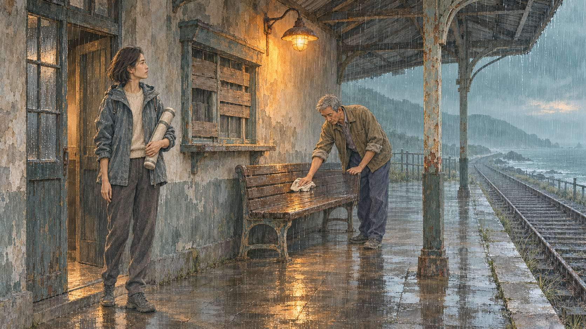
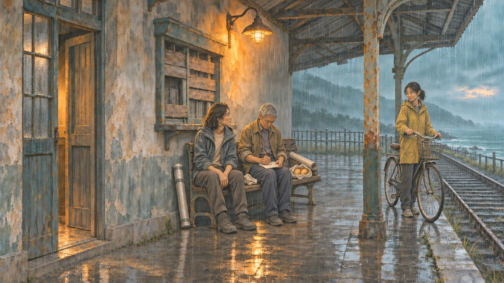

# 用《末班灯》完成三幅连续插图

目标：理解一篇小说如何经过人物表演、场景设定、逐图检查，成为可连续阅读的作品。无须安装制作台即可使用本教程。[English](README.en.md)

[在线阅读](https://ethereal-space-one.github.io/taleprism/) · [v0.1.0 下载](https://github.com/Ethereal-Space-one/taleprism/releases/tag/v0.1.0) · [八个模板](../../prompts/README.md)

《末班灯》是项目原创虚构短篇：改建项目成员林遥、退休值班员陈伯与骑车女孩小满，在海边旧站讨论一盏仍在使用的灯。没有当场批准改建方案，也没有承诺旧灯永久保留。正文以[原文件](../../samples/last-light/source.txt)为准。

## 先准备这些文件

下载源码或 `taleprism-v0.1.0-prompt-starter.zip` 后，保持目录结构。

| 文件，均位于 `samples/last-light/` | 用途 |
| --- | --- |
| `source.txt` | 完整原文；P00 是标题，P01—P08 是其后八段 |
| `linyao-v1.png`、`chenbo-v1.png` | 两位主角的身份参考，不是需要照搬的站姿 |
| `arrival-v1.png` | 已完成的场景母版：檐下初见 |
| `negotiation-v2.png` | 已修复的交涉图：谁来开灯 |
| `recording-v2.png` | 已补回车篮的记录图 |
| `recipe.json` | 完整编排、人物表演、场景与 11 件物件的状态 |
| `continuity-prompts-v2.json` | 历史实际生图与修复指令 |
| `continuity-review.json`、`PROVENANCE.md` | 对应图片/配方哈希、助手检查与来源；用户最终艺术复核仍待完成 |

[参考图映射](references.json)记录文件职责与校验值。[逐段原文与工作表](worksheet.json)便于复制。既有结果供对照；重新生成可能不同，必须重新检查。

## 1. 锁定原文依据与人物立场

先用[模板 01](../../prompts/01-source.md)处理原文，再用[模板 02](../../prompts/02-character.md)分析 P03。

林遥希望完成可靠的保存安排；陈伯关心的是灯是否还会被使用。她的指点停住、手收回，表现从解释转向倾听；他看着她并发问，保留谨慎与担忧。不要把她画成冷漠官僚，把他画成无理阻挠者，或让两个人同时露出已经达成协议的笑容。

原文 P03 提到“桌边”，前后却以长凳为核心。我们的美术解释是凳旁工作区域，不新增桌子；原文不改。人物坐在凳左端等姿态也标注为艺术编排，不能伪装成原文明确动作。

## 2. 用三幅图承担三种叙事作用

用[模板 03](../../prompts/03-shot-plan.md)，预算填 3。

| 镜头 | 插入位置 | 画面目的 | 此刻不能出现 |
| --- | --- | --- | --- |
| 檐下初见 | P01 后 | 建立旧站空间与两人的不同日常 | 小满、自行车、面包、已谈妥的表情 |
| 谁来开灯 | P03 后 | 看见双方立场变化与迟疑 | 小满入场、铅笔记录、方案获批 |
| 把日常记下来 | P06 后 | 从解释转为暂时合作，陈伯开始记录 | 永久保留的承诺、庆祝或施工队 |

同机位是本案例的主动选择，用于检验稳定空间；不同镜头的价值来自行动与关系变化。它不证明任意反打、绕拍也能保持一致。

## 3. 建立场景与物件状态

用[模板 04](../../prompts/04-scene.md)。门、封板窗、单灯、长凳、檐柱与铁轨以母版为准。特别核对长凳长度，不能为了让人坐下自动加长。

| 物件 | 初见 | 交涉 | 记录 |
| --- | --- | --- | --- |
| 测绘筒 | 林遥臂下 | 放在凳左靠墙处 | 留在原处 |
| 大图纸 | 卷在筒内、画外 | 铺在凳面 | 卷起留在凳右端 |
| 擦布 | 陈伯手中 | 仍在手中 | 放在两人之间凳面 |
| 自行车与车篮 | 未入场 | 未入场 | 小满带入；车篮为空 |
| 面包与布包 | 随小满，未入场 | 未入场 | 从车篮取出，放到干燥凳面 |
| 小幅记录纸、铅笔 | 未使用，画外 | 未使用，画外 | 陈伯膝上与手中 |

上表是便于理解的摘要；完整 11 件物件与每次变化理由见工作表。放筒、卷图、放布是衔接解释。大图纸、小记录纸、擦布、面包布包分别管理。

## 4. 获得并检查第一幅图

有两种练习方式：直接使用现成 `arrival-v1.png` 学习后续编辑；或将两张角色参考图上传到支持参考图的生图工具，使用[模板 05](../../prompts/05-first-image.md)生成自己的母版。

生成后用[模板 07](../../prompts/07-review.md)对照原文检查身份、布局和道具。母版不过关，就先修母版；不要继续生成两张建立在错误家具上的图片。

## 5. 在母版上制作交涉图

编辑目标是你的已检查母版。填入 P03 的人物状态与物件变化，使用[模板 06](../../prompts/06-continuation.md)：两人调整姿态，图纸打开，筒放在凳左靠墙处；建筑、机位和长凳尺寸保持。

历史上，这一步的候选把长凳向左加长了。我们没有带着问题继续，而是用母版对照，局部恢复原来的宽度和位置，再核对人物坐姿与筒的位置。完整修复指令保存在 `continuity-prompts-v2.json`。那个中间候选未作为公开文件归档，因此不要把旧版 v1 图误认为这次返工前的候选。

## 6. 从已检查的交涉图继续到记录图

参考顺序：第一张是交涉图，作为编辑目标与前序依据；第二张是 `arrival-v1.png`，作为固定环境母版。用 P06 的状态表填[模板 06](../../prompts/06-continuation.md)。陈伯坐下记录，小满带车与面包已在 P05 入场；图纸卷起，筒、布、面包、小纸与铅笔各有去处。

这次候选遗漏了原文明确提到的车篮。使用[模板 08](../../prompts/08-repair.md)仅补空车篮，并保护人物表情、姿态、家具与其他物件。车篮是空的，因为面包已经取到凳面。修复后仍要检查全图，不能把“已发修复指令”当作修复成功。

## 7. 对照旧方法，检查自己的结果

[交涉旧图 v1](../../samples/last-light/negotiation-v1.png) → [连续性修订 v2](../../samples/last-light/negotiation-v2.png)；[记录旧图 v1](../../samples/last-light/recording-v1.png) → [连续性修订 v2](../../samples/last-light/recording-v2.png)。这些展示整体流程迭代；长凳和车篮的中间返工另见文字记录。

同时打开母版、上一张通过检查的图和当前图。逐项核对：原文瞬间、人物身份、双方心理外化、固定几何、道具状态。记录实际观察、仍不确定之处与检查者。上游图片发生实质变化，重新检查依赖它的后续镜头。细微笔触和局部轮廓仍可能有重绘差异；本流程不保证逐像素不变。

## 8. 把结果交给读者

只练模板，可把原文、镜头位置、成图和检查表整理后分享。需要连续阅读成品，按[制作台快速上手](../../docs/快速上手.md)安装，导入原文并审校人物，在“章节制作方案”填写方案、回填图片并检查，再应用到阅读器，导出独立阅读 ZIP。

想先查看已完成工程，在 Release 下载 `last-light-project.zip` 对应的完整文件名，进入“示例与工程 → 导入可编辑工程”。每次导入创建新项目；公开示例不含系统演示音频。阅读器 ZIP 用于阅读，工程 ZIP 用于编辑，两者不能互换。

配音是可选步骤：先选几句关键对白、本机合成、试听后接受。模板或图片工具不会自动替你完成声音制作。公开示例尚未经过独立外部用户验证，欢迎提交具体卡住的步骤与画面问题。
